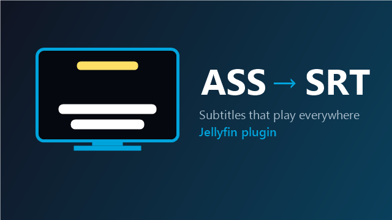

# ASS to SRT — Jellyfin plugin



🇬🇧 [English](#english) · 🇫🇷 [Français](#français)

---

## English

**Your anime won't play smoothly on your TV because of ASS subtitles? This plugin fixes it.**

Many anime ship with **ASS/SSA** subtitles (colors, fonts, positions). Some Jellyfin clients cannot display them — **Jellyfin for Android TV / Fire TV, Roku**, some smart TVs. When you turn those subtitles on, the server has to **burn them into the video** (full transcoding). On a small server (NAS, Raspberry Pi, VM...) this means infinite loading or constant stuttering.

**ASS to SRT** adds an **SRT copy** of every ASS track, right next to the video. SRT is a simple format every client plays directly: no transcoding, no stutter. Jellyfin ranks external subtitles first, so the SRT is picked automatically.

### Features
- 🔍 **Scans your libraries** and converts every ASS/SSA track that has no SRT in the same language yet (embedded in MKV or external `.ass` files).
- ⚡ **Automatic**: new videos are converted about a minute after Jellyfin has analysed them.
- 🌙 **Scheduled task** every night (4:00) + a **"Convert now"** button.
- 🧱 **No overlapping text**: subtitles shown at the same time in the same area of the screen are stacked in one block. Signs (translated on-screen text) go to the top of the screen, away from the dialogue — or stay at their place, or are removed.
- 🎨 Signs in color (yellow by default), song lyrics marked with ♪ — or removed.
- 📐 Long lines split into balanced lines (42 characters by default), very short subtitles kept on screen a bit longer, optional speaker names.
- ⏭️ **Next episodes first**: when you start an episode, it and the next ones are converted right away. Mode "only prepare the next episodes" for big libraries.
- 🐢 **Gentle with small servers**: conversions slow down (or wait) while a video is playing, optional time window (e.g. 1:00–7:00).
- 🔎 **Preview with a real episode** and **convert a single series** from the settings page.
- 📊 Statistics, Jellyfin activity log entries, cleanup of the SRT files of removed videos.
- 🌍 Settings page in English, French, Spanish, German, Portuguese and Italian.
- 🙈 Optionally hide the converted ASS tracks from the subtitle menus (experimental, video files are never modified).
- 🧹 **Clean SRT**: fonts, karaoke effects and vector drawings removed. The plugin reads the ASS file itself (styles, positions), it does not rely on ffmpeg's conversion.
- 🎨 **Your style**: keep or remove italic, bold, underline, colors, positions (top of screen), one line per subtitle — with a live preview in the settings.
- 🏷️ **Real track names**: `FR Full [ASS] - Crunchyroll` shows up as `FR Full [SRT] - Crunchyroll`.
- 🌍 **Languages filter** (e.g. only `fr, en`), forced tracks as `.forced.srt`, "Signs / Songs" tracks skipped (all optional).
- 🔁 **Regenerate** button: changed a setting? The SRT files created by the plugin are rebuilt with the new settings (your own SRT files are never touched).
- ♻️ **Never touches your video files** and keeps the ASS tracks: it only adds `.srt` files. If the media folder is read-only, the SRT goes to Jellyfin's metadata folder instead.
- Uses Jellyfin's own ffmpeg: nothing else to install.

### Installation
1. Jellyfin → **Dashboard → Plugins → Repositories** → **+**
2. Name: `ASS to SRT` — URL:
   ```
   https://raw.githubusercontent.com/ZombieEvil/jellyfin-plugin-ass-to-srt/main/manifest.json
   ```
3. **Catalog** → **ASS to SRT** → **Install**, then **restart Jellyfin**.
4. Open the plugin settings, choose your libraries and click **Save and convert now**.

Requires **Jellyfin 12.0 or newer**.

### Output files
| Source track | Created file |
|---|---|
| `FR Full [ASS] - Crunchyroll` (French) | `Episode.FR Full [SRT] - Crunchyroll.fra.srt` |
| French, forced | `Episode.fra.forced.srt` |
| External `Episode.fr.ass` | `Episode.fr.default.srt` |

### Limits
- SRT cannot store outline, shadow, font, size or background: every Jellyfin app applies its own, set them in the app's subtitle settings. Karaoke effects are lost. The ASS track is still there for clients that support it.
- Jellyfin hides track names containing "forced" (it reads them as the forced flag).
- Extracting an embedded track reads the whole video file once (it can take a minute for a large file on a network share).

---

## Français

**Tes animes saccadent ou chargent à l'infini sur ta télé à cause des sous-titres ASS ? Ce plugin règle le problème.**

Beaucoup d'animes ont des sous-titres **ASS/SSA** (couleurs, polices, positions). Certaines applis Jellyfin ne savent pas les afficher : **Jellyfin pour Android TV / Fire TV, Roku**, certaines télés. Quand tu actives ces sous-titres, le serveur doit les **incruster dans la vidéo** (transcodage complet). Sur un petit serveur (NAS, Raspberry Pi, VM...), ça donne un chargement infini ou des coupures en permanence.

**ASS to SRT** ajoute une **copie SRT** de chaque piste ASS, juste à côté de la vidéo. Le SRT est un format simple que toutes les applis lisent directement : zéro transcodage, zéro coupure. Jellyfin met les sous-titres externes en premier, donc le SRT est choisi automatiquement.

### Fonctionnalités
- 🔍 **Scanne tes médiathèques** et convertit chaque piste ASS/SSA qui n'a pas encore de SRT dans la même langue (intégrée au MKV ou fichier `.ass` séparé).
- ⚡ **Automatique** : les nouvelles vidéos sont converties environ une minute après leur analyse par Jellyfin.
- 🌙 **Tâche planifiée** chaque nuit (4 h) + un bouton **« Convertir maintenant »**.
- 🧱 **Plus aucun texte qui se chevauche** : les sous-titres affichés en même temps dans la même zone de l'écran sont empilés dans un seul bloc. Les panneaux (textes à l'image traduits) vont en haut de l'écran, loin des dialogues — ou restent à leur place, ou sont supprimés.
- 🎨 Panneaux en couleur (jaune par défaut), paroles des chansons marquées avec ♪ — ou supprimées.
- 📐 Lignes trop longues coupées proprement (42 caractères par défaut), sous-titres très courts affichés un peu plus longtemps, nom du personnage en option.
- ⏭️ **Les prochains épisodes d'abord** : quand tu lances un épisode, il est converti tout de suite avec les suivants. Mode « préparer seulement les prochains épisodes » pour les grosses collections.
- 🐢 **Doux avec les petits serveurs** : les conversions ralentissent (ou attendent) pendant la lecture d'une vidéo, plage horaire en option (ex. 1 h – 7 h).
- 🔎 **Aperçu avec un vrai épisode** et **conversion d'une seule série** depuis la page de réglages.
- 📊 Statistiques, messages dans le journal d'activité de Jellyfin, nettoyage des SRT des vidéos supprimées.
- 🌍 Page de réglages en français, anglais, espagnol, allemand, portugais et italien.
- 🙈 Option pour masquer les pistes ASS converties dans les menus (expérimental, les vidéos ne sont jamais modifiées).
- 🧹 **SRT propres** : polices, effets karaoké et dessins vectoriels retirés. Le plugin lit lui-même le fichier ASS (styles, positions) au lieu de dépendre de la conversion de ffmpeg.
- 🎨 **Ton style** : garder ou enlever l'italique, le gras, le soulignement, les couleurs, les positions (haut de l'écran), une seule ligne par réplique — avec un aperçu en direct dans les réglages.
- 🏷️ **Vrais noms de pistes** : `FR Full [ASS] - Crunchyroll` apparaît comme `FR Full [SRT] - Crunchyroll`.
- 🌍 **Filtre de langues** (ex. seulement `fr, en`), pistes forcées en `.forced.srt`, pistes « Signs / Songs » ignorées (tout est réglable).
- 🔁 Bouton **Régénérer** : tu as changé un réglage ? Les SRT créés par le plugin sont refaits avec les nouveaux réglages (tes propres SRT ne sont jamais touchés).
- ♻️ **Ne modifie jamais tes vidéos** et garde les pistes ASS : il ajoute seulement des `.srt`. Si le dossier est en lecture seule, le SRT va dans le dossier de métadonnées de Jellyfin.
- Utilise le ffmpeg de Jellyfin : rien d'autre à installer.

### Installation
1. Jellyfin → **Tableau de bord → Extensions → Dépôts** → **+**
2. Nom : `ASS to SRT` — URL :
   ```
   https://raw.githubusercontent.com/ZombieEvil/jellyfin-plugin-ass-to-srt/main/manifest.json
   ```
3. **Catalogue** → **ASS to SRT** → **Installer**, puis **redémarre Jellyfin**.
4. Ouvre les réglages du plugin, choisis tes médiathèques et clique sur **Save and convert now**.

Nécessite **Jellyfin 12.0 ou plus récent**.

### Limites
- Un SRT ne peut pas contenir de contour, d'ombre, de police, de taille ni de fond : chaque appli Jellyfin applique les siens, à régler dans les paramètres de sous-titres de l'appli. Le karaoké est perdu. La piste ASS reste disponible pour les applis qui la gèrent.
- Jellyfin masque les noms de pistes qui contiennent « forced » (il les lit comme le drapeau « forcé »).
- Extraire une piste intégrée lit toute la vidéo une fois (ça peut prendre une minute pour un gros fichier sur un partage réseau).

---

## Build from source / Compiler

```bash
dotnet build Jellyfin.Plugin.AssToSrt/Jellyfin.Plugin.AssToSrt.csproj -c Release
```
Copy `Jellyfin.Plugin.AssToSrt.dll` into `<jellyfin-data>/plugins/ASS to SRT/` and restart Jellyfin.

Releases: publishing a GitHub release tagged `vX.Y.Z` builds the plugin and updates `manifest.json` automatically.

## License

GPL-3.0
